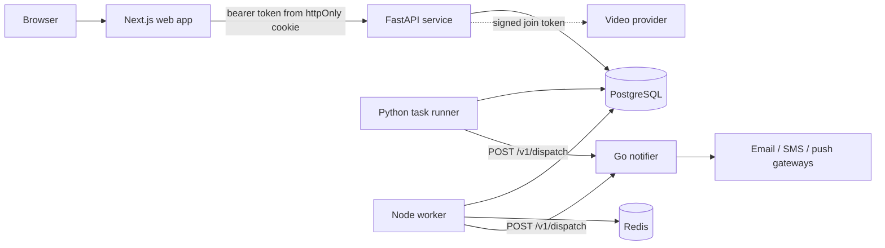

<div align="center">

# Truewell

**One secure place for appointments, video visits, prescriptions, lab results and care plans, for patients and the clinicians who care for them.**

[](https://github.com/your-org/Truewell/actions/workflows/ci.yml)
[](LICENSE)
[](https://www.typescriptlang.org/)
[](https://www.python.org/)
[](https://fastapi.tiangolo.com/)
[](https://nextjs.org/)
[](https://go.dev/)
[](https://www.prisma.io/)
[](https://nodejs.org/)

</div>

---

## Overview

Healthcare is fragmented for the people receiving it: one portal for booking, another for results, a phone call to
refill a prescription, a paper statement for the bill. Care teams face the mirror image, switching between schedules,
inboxes, lab queues and claims screens.

Truewell brings those workflows into one system. Patients book and cancel visits, join a browser-based video waiting
room, read lab results with reference ranges, follow a care plan, message their care team and see what insurance
covered. Clinicians get a dashboard with today's schedule, a lab review queue, e-prescribing with interaction and
allergy checks, and a secure inbox. Billing staff work a claims list that surfaces denials first.

The Python FastAPI service is the primary backend. A Next.js 14 app serves both the patient portal and the clinician
dashboard, a Node worker handles maintenance jobs, and a small Go service delivers reminders with throttling and quiet
hours.

> Truewell implements technical safeguards in the spirit of HIPAA-style requirements but is not certified or audited.
> See [docs/security.md](docs/security.md) for what is implemented and what operators remain responsible for.

## Features

- **Patient portal**: overview, appointments with open-slot booking and cancellation rules, prescriptions, lab results
  with trend charts, care plans with task checklists, secure messaging, billing and insurance, profile.
- **Scheduling**: conflict detection per clinician, 20-minute slot generation, an appointment state machine and a
  two-hour cancellation notice for patients.
- **Telehealth**: waiting room that opens ten minutes early, HMAC-signed 30 minute join tickets, session lifecycle.
- **E-prescriptions**: draft, sign and send; drug interaction and allergy checks; controlled substance rules.
- **Lab results**: automatic abnormal flags, critical values held for clinician review, delayed release to patients.
- **Care plans**: goals, tasks assigned to patients or staff, progress summary, status transitions.
- **Clinician dashboard**: today's schedule, panel statistics, patient search and chart, lab review, inbox.
- **Insurance and claims**: policies, claim lines, submit and adjudicate flows, patient responsibility estimates.
- **Reminders**: automatic creation for confirmed visits, delivery through the notifier with retry and backoff.
- **Audit and access control**: role-based routes, record-level scoping and an audit entry for every chart access.

## Architecture



More detail in [docs/architecture.md](docs/architecture.md).

## Tech stack

| Layer | Technology |
| --- | --- |
| Backend API | Python 3.11, FastAPI, SQLAlchemy 2, Pydantic 2, PyJWT, pytest |
| Web | Next.js 14 (App Router), React 18, TypeScript 5, SWR, Zod, Vitest |
| Shared packages | `@truewell/types`, `@truewell/utils`, `@truewell/ui`, `@truewell/api-client` |
| Data | PostgreSQL 16, Prisma schema and migrations, Redis 7 |
| Notifications | Go 1.22 (`services/notifier`) |
| Worker | Node 20, BullMQ, Jest |
| Delivery | Docker, Docker Compose, Kubernetes manifests, GitHub Actions |

## Project structure

```
Truewell/
├── apps/
│   ├── web/                    Next.js 14 app (patient portal + clinician dashboard)
│   │   └── src/
│   │       ├── app/            routes: (auth), portal/*, clinician/*, api/* route handlers
│   │       ├── components/     appointments, telehealth, prescriptions, labs, care, messaging, billing, clinician
│   │       ├── hooks/          SWR resource hooks, session, countdown, open slots, form state
│   │       ├── lib/            proxy, session, rbac, env, server-api, logger
│   │       └── services/       pure dashboard, appointment, lab, billing and messaging logic
│   └── worker/                 Node worker: jobs, queue, schedule, tests
├── packages/
│   ├── types/                  domain interfaces and enums
│   ├── utils/                  dates, money, lab ranges, PHI masking
│   ├── ui/                     accessible React primitives
│   └── api-client/             typed client for the web API
├── services/
│   ├── api/                    FastAPI backend
│   │   ├── app/                routers, services, repositories, models, schemas, tasks, core
│   │   └── tests/              pytest suite
│   └── notifier/               Go reminder dispatcher (cmd/, internal/)
├── prisma/                     schema.prisma, timestamped migrations, seed.ts
├── scripts/                    check-env, gen-openapi, seed-slots, backup-db, release-notes
├── docs/                       architecture, api, data-model, security, deployment, testing, telehealth
├── deploy/                     docker-compose, Dockerfiles, k8s manifests
├── .github/                    workflows, issue templates, dependabot, CODEOWNERS
├── Makefile
└── .env.example
```

## Getting started

Requirements: Node 20, Python 3.11, Go 1.22, Docker.

```bash
git clone https://github.com/your-org/Truewell.git && cd Truewell
cp .env.example .env
npm ci
pip install -r services/api/requirements-dev.txt

make up          # postgres, redis, api, tasks, notifier, web, worker (Docker Compose)
make migrate     # prisma migrate deploy
make seed        # fictional demo data
make dev         # web on http://localhost:3000
```

Other targets: `make api` (uvicorn with reload on :8000), `make worker`, `make notifier`, `make check-env`,
`make openapi`, `make down`.

Key variables from `.env.example`: `DATABASE_URL`, `TRUEWELL_DATABASE_URL`, `TRUEWELL_API_URL`,
`TRUEWELL_JWT_SECRET`, `TRUEWELL_VIDEO_SIGNING_KEY`, `TRUEWELL_NOTIFIER_URL`, `NOTIFIER_API_TOKEN`, `REDIS_URL`.
Seeded sign-ins use `*.example` addresses, for instance `sam.patel@patients.example` (patient) and
`dr.rivera@truewell.example` (clinician).

## API overview

All routes live under `/api/v1` on the FastAPI service (OpenAPI at `/docs` in development). Every resource supports
`GET`, `POST`, `GET /{id}`, `PATCH /{id}` and an admin-only `DELETE /{id}`. Full reference in [docs/api.md](docs/api.md).

| Area | Routes |
| --- | --- |
| Auth | `POST /auth/register`, `POST /auth/login`, `POST /auth/refresh`, `POST /auth/logout`, `GET /auth/me` |
| Scheduling | `/appointments`, `/appointment-types`, `/availability`, `GET /scheduling/open-slots` |
| Telehealth | `/telehealth/sessions`, `POST /telehealth/sessions/{id}/join`, `POST /telehealth/sessions/{id}/end` |
| Prescriptions | `/prescriptions`, `POST /prescriptions/{id}/send`, `POST /prescriptions/{id}/cancel`, `/medications`, `/pharmacies`, `/allergies` |
| Labs | `/lab-orders`, `/lab-results` |
| Care plans | `/care-plans`, `GET /care-plans/{id}/progress`, `/care-plan-goals`, `/care-plan-tasks` |
| Messaging | `/message-threads`, `/messages`, `POST /messages/{id}/read`, `/message-attachments`, `/documents` |
| Insurance | `/insurance/policies`, `/insurance/claims`, `POST /insurance/claims/{id}/submit`, `POST /insurance/claims/{id}/adjudicate` |
| Reminders | `/reminders`, `/notifications` |
| Directory | `/patients`, `/clinicians`, `/organizations`, `/locations`, `/users` |
| Health | `GET /healthz`, `GET /readyz` |

## Data model

`prisma/schema.prisma` defines 30 models and 12 enums, grouped into identity, scheduling, telehealth, pharmacy,
laboratory, care coordination, messaging, billing and platform tables. Table names are snake_case through `@@map`;
indexes follow the main query paths (calendars, reminder scans, result history, audit lookups). Four timestamped
migrations under `prisma/migrations` build the schema, and `prisma/seed.ts` loads a fictional clinic, clinicians,
patients, a confirmed video visit, a prescription, lab results, a care plan, a policy and a claim.
See [docs/data-model.md](docs/data-model.md).

## Testing

```bash
make test        # web + packages (Vitest), worker (Jest), API (pytest), notifier (go test)
make lint        # ESLint, ruff, go vet
npx prisma validate
```

The API suite runs against in-memory SQLite and covers scheduling, state machines, lab flags, interaction checks,
authentication and row-level scoping. See [docs/testing.md](docs/testing.md).

## Deployment

`make up` runs the full stack with Docker Compose. Release tags build four images (`web`, `worker`, `api`, `notifier`)
to GHCR, and `deploy/k8s` contains namespace, deployments, services, ingress and network policies. Run
`npx prisma migrate deploy` before rolling the API. See [docs/deployment.md](docs/deployment.md).

## Security

Passwords use scrypt, access tokens last 15 minutes, refresh tokens rotate on use and live in path-scoped `httpOnly`
cookies, every router declares allowed roles, chart access is audited, and logs redact sensitive fields. Critical lab
values are never released automatically. These are technical safeguards only; deploying Truewell does not by itself
make an organisation compliant with any regulation. Read [docs/security.md](docs/security.md) and report issues
privately as described in [SECURITY.md](SECURITY.md).

## Roadmap

- [ ] Enforced multi-factor authentication for staff accounts
- [ ] Redis-backed login throttling for multi-replica deployments
- [ ] Group visits and waitlist for cancelled slots
- [ ] FHIR export for lab results and medications
- [ ] Native push notifications through the notifier
- [ ] Integration with a licensed clinical knowledge base for interaction checking

## Contributing

Contributions are welcome. Read [CONTRIBUTING.md](CONTRIBUTING.md) and the [Code of Conduct](CODE_OF_CONDUCT.md), and use
only fictional data in issues, tests and screenshots.

## License

Released under the [MIT License](LICENSE).
