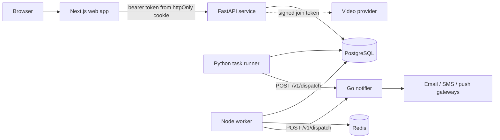

# Architecture

Truewell is a multi-service system. The browser only ever talks to the Next.js app; the Next.js app
talks to the Python API; background work is split between a Python scheduler, a Node worker and a small Go
notifier. PostgreSQL is the single system of record.



## Components

| Component | Path | Responsibility |
| --- | --- | --- |
| Web app | `apps/web` | Patient portal (`/portal/*`), clinician dashboard (`/clinician/*`), route handlers that proxy to the API |
| API | `services/api` | Authentication, authorisation, business rules, persistence, audit trail |
| Task runner | `services/api/app/tasks` | Reminder creation and dispatch, lab release, no-show marking |
| Worker | `apps/worker` | Queue-backed maintenance jobs: reminder scan/dispatch, lab release, claims sweep, session cleanup |
| Notifier | `services/notifier` | Channel routing, per-patient throttling, quiet hours, retry |
| Shared packages | `packages/*` | Types, pure utilities, UI primitives, typed API client |
| Database | `prisma` | Schema, migrations and seed data |

## Request flow

1. The browser calls a Next.js route handler such as `POST /api/appointments`.
2. `middleware.ts` verifies that a non-expired session cookie exists and that the role may use the route.
3. The handler validates the body with Zod, converts keys from camelCase to snake_case and forwards the request to
   `/api/v1/appointments` with `Authorization: Bearer <access token>`.
4. FastAPI decodes the token into a `Principal`, selects the router dependency for the role, and calls a service.
5. The service enforces business rules (conflict detection, state machines, safety checks), persists through a
   repository and writes an `audit_logs` row.
6. The response is converted back to camelCase and returned with `Cache-Control: no-store`.

Server components skip step 1 and call the API directly through `lib/server-api.ts`, using the same cookie.

## Backend layering

```
routers/       HTTP shape, role dependencies, pagination
services/      business rules, state machines, audit, row-level scoping
repositories/  SQLAlchemy queries, one class per aggregate
models/        ORM mapping, mirrors prisma/schema.prisma
schemas/       Pydantic request and response models
tasks/         scheduler and recurring jobs
```

`CrudService` supplies audited create/read/update/delete with patient scoping. Domain services (appointments,
prescriptions, lab results, claims, reminders, telehealth, messages, care plans) subclass it and override hooks such
as `before_create` and `before_update`.

## State machines

- Appointments: `REQUESTED -> CONFIRMED -> CHECKED_IN -> IN_PROGRESS -> COMPLETED`, with `CANCELLED` and `NO_SHOW` exits.
- Telehealth sessions: `SCHEDULED -> WAITING_ROOM -> LIVE -> ENDED`.
- Prescriptions: `DRAFT -> SENT -> FILLED`, with `CANCELLED` and `EXPIRED`.
- Claims: `DRAFT -> SUBMITTED -> ACCEPTED -> PAID`, with `DENIED -> APPEALED`.
- Care plans: `DRAFT -> ACTIVE <-> ON_HOLD -> COMPLETED`, or `REVOKED`.

## Schema ownership

Prisma owns migrations. SQLAlchemy models are hand-maintained mirrors, and a CI step (`migrations-check`) replays all
migrations against PostgreSQL and diffs them against the Prisma schema. The `test_domain_registry` suite ensures every
model has a matching read schema and router.

## Failure behaviour

- If the API is unreachable the web layer returns `502 upstream_unavailable` and the UI shows a retry state.
- Reminder delivery failures are retried with exponential backoff up to three attempts, then marked `FAILED`.
- The notifier defers non-urgent messages during quiet hours instead of dropping them.
