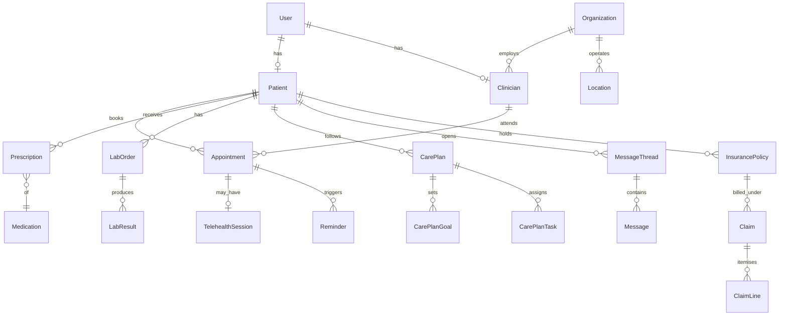

# Data model

The schema lives in `prisma/schema.prisma` (30 models, 12 enums). Table names are snake_case through `@@map`.
Identifiers are `cuid` strings. Timestamps are stored without time zone and always represent UTC.

## Model groups

| Group | Models |
| --- | --- |
| Identity | `User`, `Session`, `Organization`, `Location`, `Patient`, `Clinician` |
| Scheduling | `AppointmentType`, `AvailabilitySlot`, `Appointment` |
| Telehealth | `TelehealthSession`, `TelehealthParticipant` |
| Pharmacy | `Medication`, `Pharmacy`, `Prescription`, `Allergy` |
| Laboratory | `LabOrder`, `LabResult` |
| Care coordination | `CarePlan`, `CarePlanGoal`, `CarePlanTask` |
| Messaging | `MessageThread`, `Message`, `MessageAttachment`, `Document` |
| Billing | `InsurancePolicy`, `Claim`, `ClaimLine` |
| Platform | `Reminder`, `Notification`, `AuditLog` |

## Enums

`Role`, `AppointmentStatus`, `AppointmentMode`, `SessionStatus`, `PrescriptionStatus`, `LabStatus`, `AbnormalFlag`,
`CarePlanStatus`, `ClaimStatus`, `ReminderChannel`, `ReminderStatus`, `NotificationKind`.

## Indexing

Indexes follow the dominant query paths: `(patient_id, starts_at)` and `(clinician_id, starts_at)` for calendars,
`(status, send_at)` for the reminder scan, `(order_id)` and `(analyte, resulted_at)` for results, and
`(entity_type, entity_id)` for audit lookups. Unique constraints protect identifiers that must never repeat:
`mrn`, `npi`, `rxnorm_code`, `(clinician_id, starts_at)` slots and `(payer_name, member_id)` policies.

## Deletion rules

Clinical records use `RESTRICT` foreign keys so a patient or clinician cannot be removed while charts reference them;
patients are deactivated (`deactivated_at`) instead. Children that have no meaning without their parent (care plan
goals, claim lines, message attachments) cascade. `AuditLog.actor_id` is set to null if a user is removed so the trail
survives.

## Migrations

| Folder | Contents |
| --- | --- |
| `20250106090000_init_identity` | Users, sessions, organisations, patients, clinicians |
| `20250214101500_scheduling_telehealth` | Appointment types, availability, appointments, video sessions |
| `20250321143000_clinical_records` | Medications, prescriptions, allergies, labs, care plans |
| `20250519120000_messaging_billing` | Messaging, documents, insurance, claims, reminders, notifications, audit log |

Apply with `make migrate`. Seed fictional data with `make seed`.
